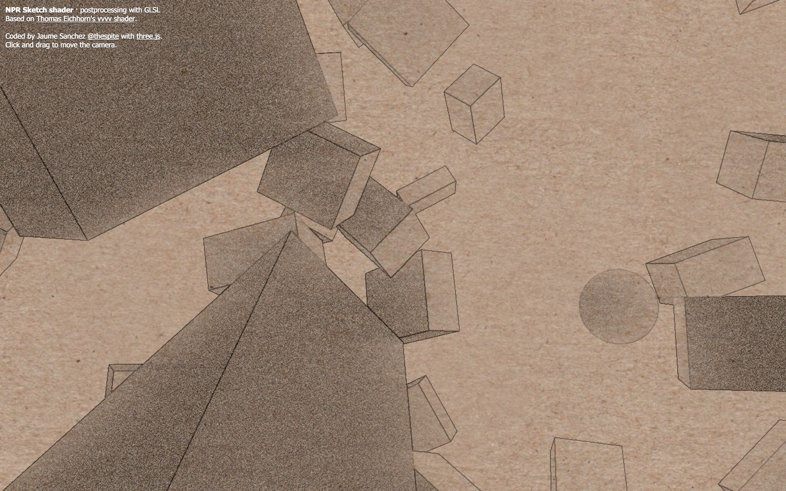

# NPR (non photorealistic rendering) shader

NPR Sketch shader · postprocessing with GLSL
Based on [Thomas Eichhorn's vvvv shader](http://www.thomaseichhorn.de/npr-sketch-shader-vvvv/)

#### Demo ####
- **[NPR Sketch shader](https://spite.github.io/npr-shading/)**: boxes drawn in pencil on brown paper. Drag to move the camera, scroll or pinch to zoom

#### 2026 update ####
**Disclaimer:** this demo is from 2012, and was last updated in 2016. three.js has no sketch effect built in, but the pieces are there: the edges here come from the normals and the depth, as the `SobelOperatorShader` in the addons finds them in a picture, and the post-processing in the addons can chain the passes

The page has been rewritten for current three.js. What changed:

- it runs on three.js r186, from a CDN with an import map, and the passes are plain render targets instead of the copies of `EffectComposer` it carried
- it's sharp on screens with more than one pixel per point, and the lines, the grain and the paper keep the same size on them
- the depth for the lines is no longer given to `clamp()` in the wrong order, which the spec leaves undefined
- the blur works from the shading that was already drawn, instead of drawing the scene once more at half the size
- it's on GitHub Pages
- the copies of three.js and its examples are gone

#### License ####

MIT licensed

Copyright (C) 2012-2016 Jaume Sanchez Elias, http://www.clicktorelease.com
